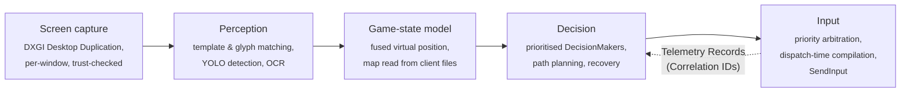

# Legends

**Real-time computer vision → game-state model → decisions → keyboard input,
running unattended against a live desktop application.**

Legends watches a running game client through screen capture, builds a model of
what is happening from the pixels alone, decides what to do next, and drives the
client with synthetic keyboard input, with several clients at once if needed. The game
(a MapleStory client) is the test environment: it is fast-moving, visually
noisy, gives no API, and punishes a wrong keypress immediately. That makes it a
demanding place to build perception, control, and recovery that hold up for
hours.

<!--
  DEMO PLACEHOLDER: replace this whole block with the GIF (or a link to a
  1–2 minute video) once it is recorded.
-->
> **🎬 Demo (coming soon)**
>
> *A 20–40 s split-screen GIF:*
>
> - **Left:** the game client, the character navigating a map (walking,
>   jumping, climbing a rope or ladder) and fighting.
> - **Right:** a live debug overlay or log tail showing what the bot sees and
>   decides: detection boxes (own character, name tag, mobs), the minimap and
>   play-area position estimates being fused into one virtual position, the
>   planned path over the map's footholds and ropes, and the Telemetry Records
>   (decision → Correlation ID → keys dispatched) scrolling as it acts.
> - Ideally one moment where something goes wrong (blocked, knocked back) and
>   the recovery ladder visibly kicks in.

## At a glance

| | |
| --- | --- |
| **Production code** | ~45k lines of Python across the engine, the game layer, and the game-data reader |
| **Tests** | ~3,500 pytest tests (~49k lines), including regression tests over labelled recorded frames |
| **History** | 1,100+ commits since Oct 2023, 4 architecture decision records |
| **Quality gates** | CI on every PR: Ruff and Pyright on the changed files (strict where it has been earned) plus the full test suite; import layering enforced by a test |
| **Stack** | Python 3.14, OpenCV, Ultralytics YOLO, PyTorch, Tesseract, DXGI Desktop Duplication, Win32 `SendInput`, asyncio + multiprocessing |

<!--
  TODO: add measured runtime numbers here when available, e.g. capture/perception
  FPS, decision-to-keypress latency (from Telemetry Records), position accuracy
  vs. labelled frames, longest unattended Session.
-->

## How it works



The pipeline is split across processes. **Engine** processes read the clients
and decide; a single **Main Process** owns every keystroke. A decision never
presses a key: it sends an `ActionRequest` across a process boundary, and Main
Process arbitrates by priority, compiles the movement against the keys that
are actually held at that instant, and sends it.


[docs/ARCHITECTURE.md](docs/ARCHITECTURE.md) walks the path from a decision to
a keystroke end to end, plus the control, observability, and shared-state
planes.

## Hard problems it solves

**Knowing where you are from pixels alone.** The minimap gives a position good
to about 16 game units, too coarse for grabbing a rope or landing on a narrow
platform. The play area is precise but crowded with other characters, pets and
chat balloons. Position comes from fusing the two: play-area detections are
projected into map coordinates through a camera model and kept only if they
agree with the minimap. Our own character is identified by its learned name tag,
and still found when that tag is partly hidden behind foreground scenery. When
the sources disagree, the state is `UNSURE` rather than a guess.
([`maple/screen/position/fusion.py`](maple/screen/position/fusion.py))

**Ground truth from the client's own files, not hand-drawn maps.**
`game_data/` reads the client's data archives to extract every map's
footholds, ropes, ladders, portals, layers and minimap transform. Navigation
works in the game's own virtual coordinates, and a new map needs no
hand-drawn file. ([ADR 0004](docs/adr/0004-virtual-coordinates-and-map-from-game-data.md))

**Reliable perception under changing visuals.** Captures are checked for
trust (a window in front of the client, a UAC prompt or the lock screen must
not be read as game pixels). Text the client's font files can't reproduce
(blended countdown digits, unantialiased chat) is read with glyph masks
harvested from real frames. Detection is regression-tested against versioned,
labelled frame sets.

**Input timing that stays correct under preemption and multiple clients.**
`SendInput` only reaches the foreground window, and a held key changes how the
next movement must be keyed. So movement is compiled at dispatch time, inside
the focus lock, against a Main Process **Held-Keys Ledger** that records what
was actually delivered. When a higher-priority action cuts a movement short,
every direction key is released, so a preempted character never keeps walking.
([ADR 0002](docs/adr/0002-dispatch-time-compilation-held-keys-ledger.md))

**Recovering from unexpected states.** A symptom-keyed recovery monitor
(stall, stagnation, plan churn, timeouts) escalates through a **Reaction
Ladder**. A **Delivery Gate** stops "stuck" timers whenever no movement was
actually sent, so casting in place is never mistaken for being stuck, and a
character pinned against a wall while its coordinates jitter is still caught.
([`maple/movement_recovery.py`](maple/movement_recovery.py))

**Measuring behaviour instead of eyeballing it.** Every decision emits
structured JSONL Telemetry Records tied together by a Correlation ID that
follows it across the process boundary to the keys it caused. A closed-loop
**Trial** framework runs movement experiments from a schedule, sweeps controller
parameters, and compares runs numerically.
([ADR 0001](docs/adr/0001-logging-architecture.md))

## How it's built

- **Layered packages, enforced.** `botting/` is a game-agnostic engine
  (processes, input, capture, logging, telemetry). `maple/` is the game layer
  on top. `game_data/` reads client files and imports neither.
  `tests/test_layering.py` fails the build on an import that points the wrong
  way.
- **Invariants that crash, not conventions.** Input functions raise outside
  Main Process. Banned APIs (direct input libraries, `xfail`, ambient context
  for Correlation IDs) are lint errors.
- **A typing ratchet.** Pyright `standard` across the repo, `strict` grown one
  directory at a time ([ADR 0003](docs/adr/0003-progressive-typing-ratchet.md)).
- **Testable seams.** Decision logic (Trial driver, recovery monitor) is fed a
  position and a clock and answers, so it is checked offline with no game
  client. Tests that need a client, real frames or game files sit behind opt-in
  markers.
- **A shared domain vocabulary.** [CONTEXT.md](CONTEXT.md) defines the terms
  used in code, tests, and issues. Architecture decisions are recorded in
  [docs/adr/](docs/adr/).
- **Hand-built for years, agent-assisted recently.** I designed and wrote
  Legends alone, without AI tools, for years: the history from October 2023
  to August 2026 has no AI-assisted commits. Since August 2026, work has been
  planned as epics and tickets and largely carried out by AI coding agents
  under written conventions
  ([AGENTS.md](AGENTS.md), [docs/agents/](docs/agents/)). Ticket PRs get an
  automated review against the ticket and its epic's intent, and a human
  reviews and merges everything that reaches `dev`.

```
pytest      # ~3,100 default tests, no game client needed
```

## Repository map

| Directory | What it is |
| --- | --- |
| `botting/` | Game-agnostic engine: process orchestration, priority arbitration, input, screen capture and matching, logging, telemetry. |
| `maple/` | Game layer: screen reading, position fusion, movement planning and compilation, decision-making, recovery, calibration. |
| `game_data/` | Reader for the client's data archives: maps, footholds, sprites, catalogue. |
| `ml_training/` | Detection-model pipeline: capture, annotate, train, version, promote. |
| `toolkit/` | Standalone analysis and inspection tools (Trial reports, dataset inspection, profiling). |
| `tests/` | The pytest suite. |
| `docs/` | Architecture, ADRs, setup, and agent conventions. |

## Getting started

**Windows only.** The bot talks to the game through Win32 window handles,
Desktop Duplication and raw input; there is no macOS or Linux path.

Three documents, in order:

1. **[docs/SETUP.md](docs/SETUP.md)**: install Python 3.14, the dependencies,
   Tesseract, and the detection models. Do this once.
2. **[docs/FIRST_BOT.md](docs/FIRST_BOT.md)**: get the client seen, bind your
   keys, extract the game data and pick a map, write a profile, check the
   position read, and get a character farming.
3. **[CONTRIBUTING.md](CONTRIBUTING.md)**: branching, tests, and how to open a
   pull request.

The short version, once setup is done:

```
copy profiles\example.yaml profiles\yourname.yaml
notepad profiles\yourname.yaml
python -m maple.launchers.run yourname
```

### What is not in git

**Model weights.** `data/` is ignored entirely. The detection models are
published as GitHub Release assets and pinned by
[models.manifest.json](models.manifest.json):

```
python scripts/fetch_models.py           # download what this commit expects
python scripts/fetch_models.py --check   # verify what you have
```

They stay out of git because `.pt` files don't delta-compress, so every retrain
would add another 6 MB to history permanently.

**Personal configuration.** `configs/discord.ini`, `configs/game_data.ini`,
`configs/keybindings.ini`, `configs/recordings.ini` and `profiles/*.yaml` are
yours. Each has a committed template beside it (`*.example.ini`,
`profiles/example.yaml`). Everything else under `configs/` is tracked and
shared, such as the Trial schedules under `configs/trials/`.

> Automating a game client is against the terms of service of most online
> games. Whether you run it, and where, is on you.
