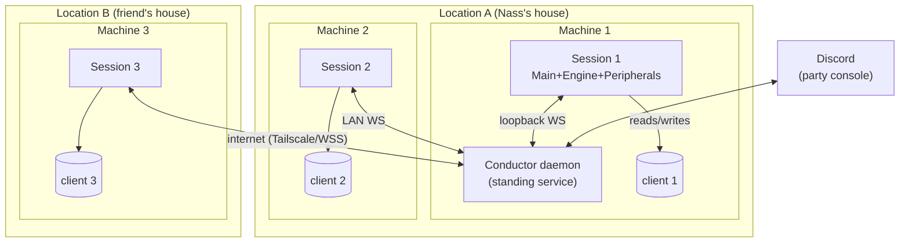
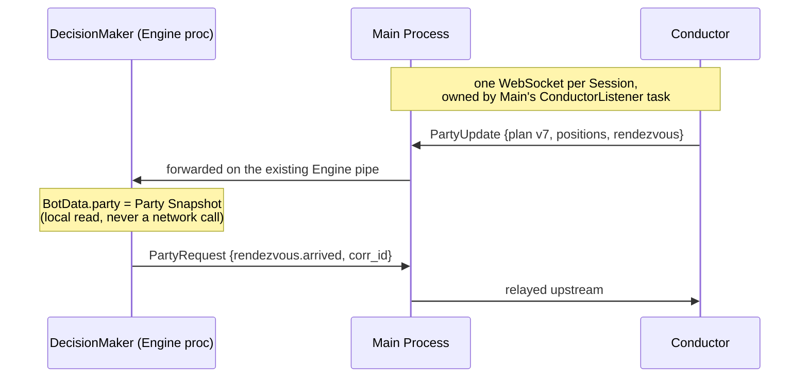

# Proposed architecture: the Conductor and its Seats

Draft v1 — 2026-08-30. The answer to "would the Coordinator be a separate
server that runs permanently, and anyone launching a bot attaches to it?" is
**yes, with one crucial qualifier**: it is a *coordination* server, never a
*control* server. Sessions attach to it, but remain fully autonomous without
it — no keystroke, failsafe, or decide cycle ever depends on its liveness.

## New domain vocabulary (draft CONTEXT.md entries)

**Conductor**:
The standing, session-independent daemon that arbitrates all party-scoped
state: membership, the Party Plan, Rendezvous, and Party Events. Exactly one
per party; it is the *single writer* of the Party Plan. Runs permanently on
one designated bot machine and outlives every Session.
_Avoid_: Coordinator (too generic — every process "coordinates" something),
server, master, hub.

**Seat**:
One machine + one game client + the Session attached to it, as a member of a
party. The unit of membership the Conductor tracks. A Seat is occupied
(session attached, heartbeating) or vacant.
_Avoid_: Node, member, peer — "member" blurs with the in-game party member;
Seat names the *slot* the machine occupies.

**Party Plan**:
The versioned document assigning each Seat its map region (a subset of
minimap features) and its roles (rebuff initiator, map-change lead, …).
Written only by the Conductor; Seats hold read-only snapshots and act on the
newest version they have seen.
_Avoid_: Assignment, strategy, config — it is runtime state, not a file.

**Rendezvous**:
A Conductor-orchestrated timed gather with an explicit state machine:
`proposed → gathering → ready → executing → done | aborted`. The mechanism
under party rebuffs, coordinated map changes, and (if kept) the session
start gate. Every phase has a deadline; `aborted` is a normal outcome, not
an error.
_Avoid_: Barrier, sync point — a Barrier has no timeout and no partial
outcome, which is exactly what a Rendezvous adds.

**Party Snapshot**:
A Seat's local, read-only copy of party state (plan version, member
positions and statuses, pending Rendezvous), pushed by the Conductor via
Main Process into each `BotData`. DecisionMakers only ever *read* the
snapshot and *send* Party Events — they never query the network
synchronously.
_Avoid_: Shared dict, party state (unqualified) — the point of the term is
that it is a stale-tolerant copy, not the authority.

**Party Event**:
One message on the party bus: presence change, position report, Rendezvous
transition, failsafe alarm, plan update, console command. Carries the
originating Seat and, where a decision caused it, that decision's
Correlation ID.
_Avoid_: Message, notification.

**Solo Fallback**:
The degraded-but-safe mode a Seat enters when the Conductor is unreachable:
keep hunting the last-assigned region, self-buff instead of party-buffing,
apply failsafes locally, retry attachment with backoff. Explicitly a normal
operating mode, not an emergency stop.

## Topology



- Each machine runs exactly what it runs today — one Session with its four
  process kinds — plus, on one designated machine, the Conductor daemon.
- The Conductor is the **fifth kind of process**, and the first that lives
  outside any Session. It is installed as a service (Task Scheduler /
  `sc.exe`), holds the party definitions, and idles at near-zero cost when no
  Seat is attached.
- ≤ 6 Seats, 2–3 locations. Cross-site links ride Tailscale (recommended) or
  WSS with token auth — see 03 §Transport.

### Authority split

| State | Authority | Others hold |
| --- | --- | --- |
| Held-Keys Ledger, action queue, minimap reads, decisions | This Seat's Main/Engine (today's rules, untouched) | nothing |
| Membership, presence, Party Plan, Rendezvous state | **Conductor** | Party Snapshot (stale-tolerant copy) |
| Positions, statuses (rebuffed, in-map), alarms | The reporting Seat (best-effort, throttled ~1 Hz) | Conductor aggregates into the snapshot it pushes |

The invariant sentence to carry into the ADR: **today "only Main Process may
press a key"; tomorrow, additionally, "only the Conductor may write the Party
Plan."** Same ethos ("priority is arbitrated in one place"), one ring further
out. Seats never self-assign regions; that is what makes split-brain
impossible by construction — a partitioned Seat just keeps its last
assignment (Solo Fallback), it never invents a new one.

## How party state reaches a DecisionMaker

The rule that keeps the existing engine intact: **the Conductor connection
belongs to Main Process**, exactly like the Discord listener, and party
traffic rides the pipes that already exist.



- **Downstream** (Conductor → Seat): `PartyUpdate` messages arrive in Main,
  which broadcasts them to its Engines over the existing duplex pipe — the
  same route command strings like `PAUSE --ign X` take today. The Engine
  writes them into `BotData.party`.
- **Upstream** (DecisionMaker → Conductor): a `PartyRequest` travels the pipe
  to Main like an `ActionRequest` does, and Main relays it. DecisionMakers
  gain no sockets, no new threads, no awareness of transport.
- **Reads are snapshots, writes are events.** A DM reading
  `self.data.party.plan` gets the local copy instantly and tolerates its
  staleness (seconds-old positions are already the norm — that's the cadence
  minimap reads run at). This is what makes internet latency a non-issue: no
  DM ever blocks on a round trip in its decide cycle.

### The PartyServices seam

DecisionMakers code against a `PartyServices` interface, not against
transport. It speaks **domain verbs, not primitives** — the lesson from
`rebuffs.py`, whose Lock/Event/dict choreography is really a gather state
machine written in low-level parts:

```python
class PartyServices(Protocol):
    # snapshot reads (local, instant)
    def plan(self) -> PartyPlan | None: ...
    def members(self) -> Mapping[str, SeatStatus]: ...   # positions, statuses
    def pending_rendezvous(self) -> Rendezvous | None: ...

    # event writes (fire-and-forget upstream)
    def report_status(self, **flags) -> None: ...        # rebuffed, in_map...
    def propose_rendezvous(self, purpose: str) -> None: ...
    def report_arrived(self, rendezvous_id: str) -> None: ...
    def raise_alarm(self, kind: str, evidence: dict) -> None: ...
```

Two backends:

- **`LocalPartyServices`** — implements the same interface over today's
  Manager proxies and shared dicts. This is what preserves single-machine
  multi-client behaviour during the whole migration: porting `PartyRebuff`
  to the interface with this backend is a pure refactor (suite stays green,
  no live behaviour change).
- **`RemotePartyServices`** — the ConductorClient path above.

The enable/disable Conditions (`decision_maker.py:47-48`) stay on Manager
proxies *within* a Session; the Conductor reaches them one level up, by
sending a command a Session translates locally — the `Bot.pause()` shape.

## Blast radius: what changes and what doesn't

(Answering "do we wrap the pipe in a websocket / does this disrupt every
DecisionMaker?" — asked 2026-08-30.)

The Engine↔Main pipe stays a real `multiprocessing.Pipe` used exactly as
today — that hop is same-machine in every deployment, so there is nothing to
wrap. The WebSocket is a *separate* link, Main↔Conductor, terminating in
Main's `ConductorListener`; DecisionMakers never see it. The pipe merely
gains two message kinds shaped like traffic it already carries:
`PartyUpdate` (Main→Engine, like today's broadcast command strings) and
`PartyRequest` (Engine→Main, like an ActionRequest that Main relays out the
socket instead of queueing).

Impact inventory:

| Code | Impact |
| --- | --- |
| Action path, movement pipeline, `controller/`, compilation | none |
| DMs using `_proxies.instance(...)` (mobs hitting, consumables, interface mixins, per-bot failsafe checks) | none — per-bot state stays local |
| `botting/core` | one branch in the Engine poll loop, one in Main's listener, a `party` attribute on `BotData`, the `ConductorListener` task in `SessionManager` |
| `Rotation` | additive: read assigned region from `BotData.party` when a plan exists, else current behaviour |
| Failsafe DMs | additive: `raise_alarm(...)` after acting locally |
| `PartyRebuff` | the one real rewrite — its Lock/Event/dict choreography becomes explicit `PartyServices` calls; ported in Phase 1 against the local backend, gated by the existing suite, before any network exists |
| Travel/regroup DM | new code |

This containment is a direct consequence of the snapshot-read / event-write
split: no decide cycle ever awaits the network, so no existing DM inherits a
new async shape or failure mode.

## The mechanics, expressed in this architecture

### Split rotation

The Party Plan assigns each Seat a subset of the map's minimap features
(the JSON map configs already enumerate features — the natural partition
unit). `Rotation` consumes its assignment from the Party Snapshot instead of
its launch-time config; everything below (pathfinding, Movement Plans,
compilation) is untouched. When membership changes, the Conductor emits plan
v+1 with regions rebalanced; each Rotation drifts to its new region on its
next decide cycle. No handshake needed — brief overlap of two bots in one
region is harmless.

### Party rebuff (Rendezvous, purpose=`rebuff`)

1. Any Seat's `PartyRebuff` DM (cooldown expiry) — or a Conductor timer —
   proposes; Conductor opens `gathering{id, point, deadline}` with the gather
   point taken from the plan.
2. Each Seat's `PartyRebuff` preempts its own `Rotation` locally (existing
   priority machinery, unchanged) and paths to the point; on arrival it
   reports `arrived` (its own minimap read is the truth — the Conductor never
   judges positions, it counts reports).
3. All arrived → Conductor broadcasts `ready`; casters cast; each Seat
   verifies its own buff icons (existing mixin) and reports `done`.
4. `complete` → rotations resume. Deadline hit → `aborted{missing}`:
   present Seats self-buff and resume, missing Seat gets a Discord alert.

This is `rebuffs.py`'s implicit state machine made explicit, with the
arbitration (today: shared Lock + distance check every instance recomputes)
moved to one place.

### Coordinated map change (Rendezvous, purpose=`travel`)

Staged variant: gather at the portal → all `arrived` → Conductor issues an
ordered `traverse` (staggered, so clients don't pile into a loading screen
simultaneously) → each Seat's `EnsureStillInMap`-style check confirms the new
map and reports → Conductor publishes the new map's Party Plan. A Seat that
misses the deadline holds in Solo Fallback on the old map and gets an alert —
the party never leaves a member silently behind.

### Party-wide failsafes

**Local-first, always.** The detecting Seat's failsafe DM acts on its own
client immediately (today's behaviour, zero new latency), *then* publishes
`alarm{kind, ign, evidence}`. The Conductor broadcasts it; every other Seat's
failsafe DM applies the configured policy — pause, logout, scatter. A Seat
cut off from the Conductor still has its full local failsafe capability;
what it loses is only the ability to warn the others.

### Console

Discord remains "the console", but at party scope: the Conductor hosts the
party-level Discord bot (one token, one channel, whole party addressable —
`STOP`, `STOP --ign X`, `TRAVEL <map>`). Commands become Party Events routed
to the target Seats, which translate them exactly as they translate Discord
commands today. Per-Seat Peripherals keep screen recording and per-client
alert screenshots; those flow upstream as alarm evidence. (Interim phases
keep today's per-session Discord untouched — see 05.)

## Failure model

| Failure | Behaviour |
| --- | --- |
| Conductor down / unreachable | Seats enter Solo Fallback: last plan kept, self-buff, local failsafes, reconnect with backoff. Nothing stops. |
| Seat silent (3 missed heartbeats, ~2 s interval) | Marked suspect; after a grace period (~30 s) Conductor rebalances the plan across remaining Seats and alerts Discord. |
| Seat rejoins | Re-attaches, presents ign + config hashes; Conductor folds it back in at the next plan version. |
| Network partition between locations | Each side degrades independently; the side with the Conductor keeps coordinating, the other goes Solo Fallback. No split-brain: only the Conductor writes plans. |
| Rendezvous deadline missed | `aborted{missing}` — a normal outcome with a defined per-purpose policy, never a hang. |
| Version skew | Attachment carries the map-config hash and a protocol version; the Conductor refuses (or flags) a mismatched Seat instead of computing plans over divergent map data. |

Design rule underneath all rows: **every cross-machine wait lives in a
DecisionMaker's decide cycle with a deadline and a fallback; none lives in
the action path.** The focus-lock critical section (ADR 0002) never contains
a network operation.

## Where the code lives

Respecting "`maple` imports `botting`, never the reverse":

| Piece | Home | Depends on |
| --- | --- | --- |
| Protocol: message types, envelope, versioning | `botting/party/protocol.py` | nothing game-specific |
| `PartyServices` + `LocalPartyServices` | `botting/party/` | existing proxy/metadata machinery |
| ConductorClient (Main-side listener task) + `RemotePartyServices` | `botting/party/client.py` | protocol |
| Conductor daemon: membership, presence, Rendezvous engine, event bus | `conductor/` (new top-level runnable) | `botting.party.protocol` |
| Planner: region splitting, gather points, buff matrix | `maple/party/planner.py` | map configs, minimap model |
| Party DecisionMakers (rebuff v2, travel, failsafe relay) | `maple/decision_makers/` | `PartyServices` |

The Conductor daemon is a deployment artifact like the launchers: it sits
*above* both packages and may import `maple` to load the planner. The
engine-side client code in `botting/party/` stays game-agnostic — it moves
opaque plans and events; only `maple` knows what a region is.

Envelope note: party messages carry `{type, seq, timestamp, seat, corr_id?,
payload}` — reusing Correlation IDs means a decision on machine A that
triggers a Rendezvous that moves machine B is one traceable chain across the
party. Whether party events also land in each Seat's `telemetry.jsonl` (and
whether the envelope gains a seat field) is an ADR-0001 question that needs
explicit sign-off — flagged in 04.

## What gets simpler (the retirement dividend)

Immediately, in one-client-per-machine operation, without deleting anything:
the focus lock is never contended; there are no focus switches, so ledger
reconciliation happens only at session start; `non_focused_inputs` and the
`BlockInput`/`SetForegroundWindow` dance never execute. The most fragile
machinery in the engine becomes dormant just by configuration.

At retirement (a later, separate ADR — see 05 phase R):

- `SharedResources.focus_lock`, `requires_focus`, `return_focus_to_owner`,
  and `non_focused_inputs.py` are deleted; `activate()` collapses to "assert
  my one client is foreground".
- Bot grouping degenerates: a Session is one Bot in one Engine, and
  `SessionManager.launch()` loses its grouping parameter.
- The launch Barrier's cross-machine descendant, if wanted, is a Rendezvous
  (`purpose=start_gate`); otherwise Seats just attach as they come up.
- ADR 0002 gets an addendum: dispatch-time compilation and the ledger remain
  (preemption still truncates sequences), but the focus-switch
  reconciliation point and the "no key survives a focus switch" assumption
  are retired with the switches themselves.
